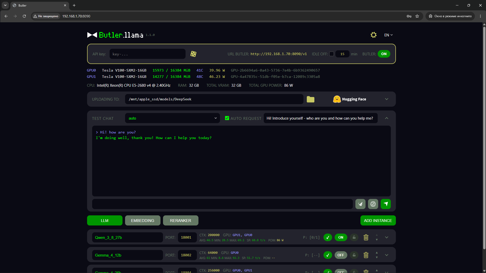
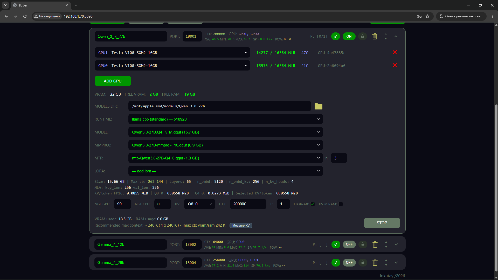
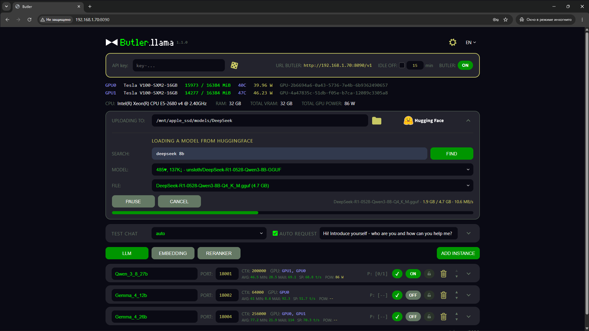

# Butler

**A small control panel for local llama.cpp models.**

Load a model when a client asks for it, release conflicting chat models from the same GPUs, and expose a single API endpoint. Manage chat, embeddings and reranking instances from a dark web interface in **English, Russian or Simplified Chinese**.


**Interface screenshots (v1.1.0):**







## Features

- GGUF model instances backed by llama.cpp Docker containers; CPU or NVIDIA GPU execution.
- Chat completions, streaming, embeddings and reranking through a shared `/v1` endpoint.
- Virtual `auto` model and load balancing across chat replicas, with context checks for text requests.
- Built-in test chat with a separate conversation for each model in the open tab.
- On-demand model loading, GPU conflict handling for chat models, optional idle unloading and per-instance idle exemptions.
- GPU memory, temperature and power monitoring; generation speed and slot indicators for chat instances.
- Model download from Hugging Face, a file manager, runtime image selection, LoRA and MTP options.
- Context-size autodetection, KV-memory calibration, and pre-launch VRAM budget estimation from GGUF metadata (MoE and hybrid architectures supported) — prevents OOM on 16–24 GB rigs.
- UI login, API keys, permission marks and RU / EN / 中文 interface switching.

## Requirements

Linux with Python 3.12+ and Docker. NVIDIA execution also needs a compatible driver and NVIDIA Container Toolkit. Native Linux is the primary deployment target; WSL2 with a Linux Docker daemon is supported for development and testing. Windows-native operation is not the primary deployment path.

Follow the official [Docker installation guide](https://docs.docker.com/engine/install/) and, for NVIDIA GPUs, the [Container Toolkit installation guide](https://docs.nvidia.com/datacenter/cloud-native/container-toolkit/latest/install-guide.html). Verify that the user running Butler can use Docker and that GPU access works before starting models.

The default runtime is `ghcr.io/ggml-org/llama.cpp:server-cuda`. See the upstream [Docker documentation](https://github.com/ggml-org/llama.cpp/blob/master/docs/docker.md). Runtime tags can change; choose a compatible image per instance when needed. Models and their licenses are separate from Butler.

## Quick start

Run these commands from a fresh checkout on Linux:

```bash
python3 -m venv .venv
.venv/bin/python -m pip install -r requirements.txt
.venv/bin/python -m pip check
.venv/bin/python scripts/setup.py
docker pull ghcr.io/ggml-org/llama.cpp:server-cuda
HOST=127.0.0.1 .venv/bin/python butler.py
```

Open **http://127.0.0.1:8090**. The setup script asks you to choose a password for `admin`, generates a random API key and JWT secret, and prepares `static/index.html` and its images. It does not replace existing credentials or saved instances. There is no published shared password to use with this setup flow.

Put your `.gguf` files in the generated `models/` directory, or choose another model directory in the UI. Add an instance, select its mode/model/GPU and assign an unused port. `0` means the instance port has not been assigned yet. Set a real port before loading it.

The pinned Python versions describe the development environment, not a complete transitive lockfile. A fresh Linux installation should be verified with `pip check`; Docker, drivers and model compatibility must also be checked on the target machine.

## Runtime images (llama.cpp versions and forks)

Butler launches models inside llama.cpp Docker containers and never pulls images by itself.

- **Default runtime:** `ghcr.io/ggml-org/llama.cpp:server-cuda` (pulled in Quick start above).
- **Auto-detection:** every llama.cpp-family image already present locally (`docker images`) shows up in the instance **RUNTIME** dropdown — pin a specific build with `docker pull <image>:<tag>` and it becomes selectable.
- **Friendly names (optional):** add a `runtimes` list to `butler_config.json` to give images readable labels:

  ```json
  "runtimes": [
    {"image": "ghcr.io/ggml-org/llama.cpp:server-cuda-b12500", "label": "llama.cpp b12500 (pinned)"}
  ]
  ```

- **Per instance:** each instance keeps its own runtime choice. Before launch Butler verifies the image exists locally and otherwise reports `Runtime image not found locally`.

## Butler ON and OFF

**ON:** permitted models can be loaded automatically when requested. A chat model may stop conflicting chat instances that share its GPUs. Small embeddings/reranking instances share GPUs with chat models.

**OFF:** requests only use already-running instances; Butler does not automatically load an unloaded model. A permission mark disables client access regardless of this switch.

Restarting Butler alone does not intentionally restart model containers. Containers use `--restart no`, so after a host/WSL restart they must be loaded manually or by a request in ON mode. Butler does not restore the previous set of loaded models at boot.

## Automatic routing and model replicas

The virtual chat model `auto` is always listed in `/v1/models` and the built-in
chat. It routes requests to already-running, ready chat instances with API
sharing enabled. With no eligible instance, requests return HTTP 503.

Chat instances may share a display name. Requests using that name select a ready,
permitted copy with the fewest outstanding requests. Equal loads are rotated;
selection and request reservation are atomic. Cold copies stay stopped while a
ready copy exists. With no ready copy, normal Butler ON auto-start is retained
for one copy; Butler OFF returns HTTP 503. Streaming requests retain their
reservation until the stream ends or disconnects.

`/v1/models` publishes a shared name once. A unique instance ID still addresses an
instance directly. If an older instance's ID also equals a shared display name,
use `instance/<id>` to select that exact copy. `auto` and the `instance/` prefix
are reserved for routing. Previously saved instances using these names remain
accessible through `instance/<id>`. The built-in chat keeps individual instance
choices alongside `auto`.

`auto` may select different models on consecutive requests; use a specific
name or instance ID when the model's capabilities or context size matter.

For text chat, automatic routing and shared names with replicas check the runtime's
context limit and count input tokens using its chat template and tokenizer.
Butler prefers models with room for the requested output as well. If the input
exceeds every measured candidate's limit, Butler returns HTTP 400. A runtime
whose limit or token count cannot be measured remains eligible. Media requests
skip text sizing. A confirmed upstream context rejection before streaming can
be retried on another ready candidate. Exact instance addresses send the
request directly to the selected instance.

### Built-in chat history

Each model instance keeps its own conversation in the open browser tab.
Switching back to a running instance restores its messages and conversation
context. Unloading or replacing its container clears that conversation.
The virtual model `auto` keeps a separate conversation for the tab.
The clear button applies to the selected conversation.

## API

Use an instance's **name or ID** as `model`. Read your API key from local configuration and configure it in your client; do not paste it into issues or commit it.

| Endpoint | Access | Purpose |
| --- | --- | --- |
| `POST /api/login` | UI credentials | Obtain access and refresh tokens |
| `GET /api/models` | UI Bearer token | List available GGUF files |
| `GET /v1/models` | API Bearer key, when configured | Discover permitted chat models and `auto` |
| `POST /v1/chat/completions` | API Bearer key, when configured | Chat and streamed chat |
| `POST /v1/embeddings` | API Bearer key, when configured | Embedding requests |
| `POST /v1/rerank` | API Bearer key, when configured | Reranking requests |

Embedding and reranking models are addressed by name/ID through their corresponding endpoints; `/v1/models` currently lists chat instances and `auto`. The API is compatible with common OpenAI-style chat/embedding clients, not an implementation of every OpenAI endpoint.

## Optional Linux service

`deploy/butler.service` is a template for a checkout at `/opt/butler`, a virtual environment at `/opt/butler/.venv`, and a local `butler` user. Adjust paths and user/group to your installation. That user must be able to read/write local configuration and access Docker; GPU containers must see the configured model directory on the Docker host.

Run setup as the intended service user before enabling the service. Keep credentials readable only by that user. After adapting the template:

```bash
sudo cp deploy/butler.service /etc/systemd/system/butler.service
sudo systemctl daemon-reload
sudo systemctl enable --now butler.service
sudo systemctl status butler.service
```

The template binds to loopback. Add a suitably configured reverse proxy/TLS and access controls before sharing outside a trusted environment. The file manager can change files anywhere the service user has access, and Docker access is powerful; Butler is an administrative tool rather than a multi-tenant hosting service. Passwords are currently stored in the ignored local JSON config.

## Development and checks

Edit the root `index.html`, then rerun `scripts/setup.py` to copy it into the served `static/` directory. UI changes need a browser refresh; Python changes need a Butler restart. Use **one server process/worker**: the instance locks and runtime state are process-local.

## Local configuration and Git

`butler_config.example.json` and `butler_instances.example.json` show the local data format. `scripts/setup.py` is the preferred way to initialize a fresh checkout; never overwrite an existing deployment's real JSON files with the examples.

## Credits

Created by **Inkutay / 2026**. Inference is provided by [llama.cpp](https://github.com/ggml-org/llama.cpp); Hugging Face is used for model discovery/downloads. Names and logos belong to their respective owners. Model weights and third-party software are not relicensed by Butler.

## Русский

Butler управляет локальными моделями llama.cpp через Docker. Интерфейс поддерживает RU / EN / 中文. Для первого запуска выполните команды Quick start: скрипт `scripts/setup.py` запросит пароль, создаст ключи и подготовит `static/`. Режим ON загружает модель по запросу, OFF использует только уже загруженные модели.

- Виртуальная модель `auto` всегда есть в списке. Она выбирает готовую модель с разрешённым API-доступом, учитывая контекст текстового запроса и нагрузку. Копии с одинаковым именем делят запросы, а `instance/<id>` адресует конкретный инстанс.
- Встроенный чат сохраняет отдельную историю для каждого инстанса и `auto` в открытой вкладке. Выгрузка или перезапуск контейнера очищает историю этого инстанса.

## 简体中文

Butler 通过 Docker 管理本地 llama.cpp 模型，界面支持俄语、英语和简体中文。首次运行请执行 Quick start 中的命令：`scripts/setup.py` 会提示设置密码、生成密钥并准备 `static/`。ON 模式按请求加载模型，OFF 模式仅使用已运行的模型。

- 虚拟模型 `auto` 始终显示在模型列表中。它会根据文本请求的上下文长度和负载，从已就绪且允许通过 API 使用的聊天实例中选择。名称相同的副本分担请求，也可通过 `instance/<id>` 指定实例。
- 内置聊天在当前浏览器标签页中为每个实例和 `auto` 分别保留对话记录。卸载或重启容器会清除该实例的记录。

## License

Copyright (C) 2026 Inkutay.

Butler source code is licensed under the [GNU Affero General Public License, version 3 only](LICENSE) (SPDX: AGPL-3.0-only). See [third-party notices](THIRD_PARTY.md) for components and marks outside this grant.
